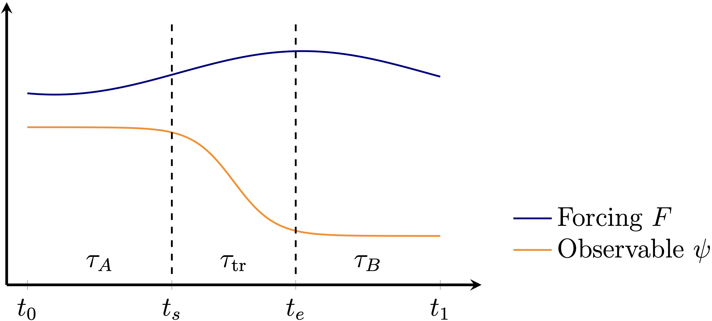

# API



Figure: Problem setting. During the time interval ``\tau``, is the system tipping in
``\psi`` under the forcing ``F``?

## Tipping test

The [`tipping_test`](@ref) method is the main function performing the tipping analysis for
a given timeseries pair of an observable ``\psi(t)`` and forcing ``F(t)``.

```@docs
tipping_test
```

The `tipping_test` function returns a `TippingTestResult`:

```@docs
TippingTestResult
```

## Null models

All null models are a subtype of the general `LinearNullModel` type.

As elementary null models, a linear damping model (`RelaxNullModel`) and the damped,
driven harmonic oscillator (`HarmonicOscillatorNullModel`) are currently implemented.

```@docs
LinearNullModel
RelaxNullModel
HarmonicOscillatorNullModel
```

## Fitting a null model
The parameters of a given `LinearNullModel` can be optimized in the [`tipping_test`](@ref)
method by setting the keyword argument `fit = true`.

Alternatively, the fitting step can be performed independently using `fit_nullmodel`.

```@docs
fit_nullmodel
```