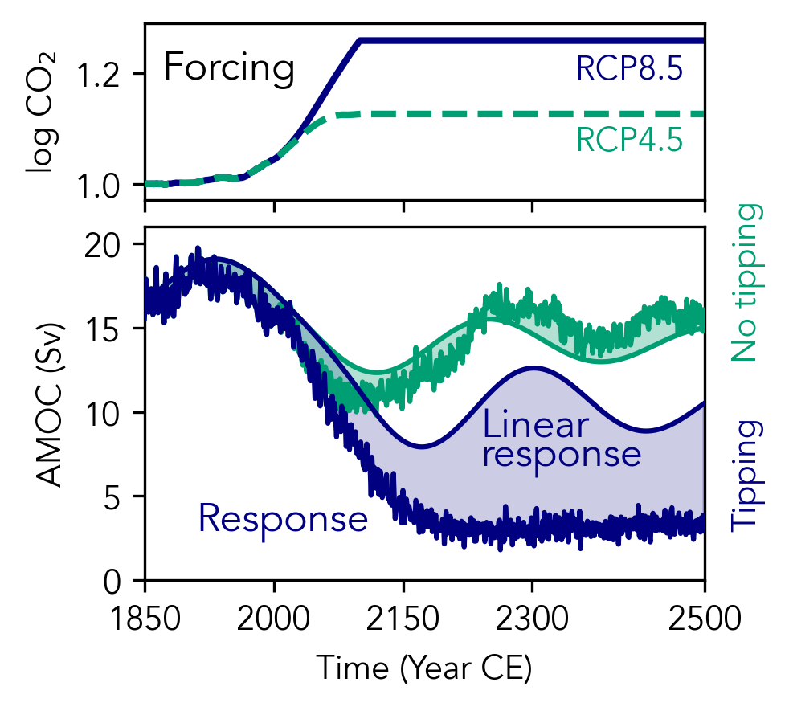

```@meta
CurrentModule = TippingTest
```

# TippingTest.jl

A Julia implementation of the tipping classification test proposed by
[Börner & Dijsktra (2026)](https://doi.org/10.5194/egusphere-2026-3507).

```@raw html

```
Figure: Example application (see [Tutorial](@ref)).

## To tip or not to tip
Given a timeseries of a system observable ``\psi(t)`` and relevant forcing ``F(t)``
over a time interval ``\tau = [t_0, t_1]``, 
the test assesses whether the system tips during ``\tau``. This assessment is based on
comparing the evolution of ``\psi(t)`` with the prediction of a linear response null
model subjected to the forcing.

For more information, see the [paper](https://doi.org/10.5194/egusphere-2026-3507).

## Installation

In Julia, add these two lines to install and load the package:

```julia
using Pkg; Pkg.add("https://github.com/reykboerner/TippingTest.jl.git")
using TippingTest
```

## Usage

See the [Tutorial](@ref) and [API](@ref) for an overview of the functionality.

The main method is the [`tipping_test`](@ref) function, which has the syntax

```julia
test = tipping_test(observable, forcing, time, (t_s, t_e);
    model=LinearNullModel(...), kwargs...)
```

and returns a [`TippingTestResult`](@ref) object.

## Citation

> Börner, R. and Dijkstra, H. A.: To tip or not to tip. [egusphere-2026-3507](https://doi.org/10.5194/egusphere-2026-3507) (2026).

BibTex:
```
@article{borner_tip_2026,
  title={To tip or not to tip},
  author={B{\"o}rner, Reyk and Dijkstra, Henk A},
  journal={Earth System Dynamics},
  year={2026},
  doi={10.5194/egusphere-2026-3507},
}
```

This work is funded by the [ClimTip](https://climate-tipping-points.eu) project.

Package maintainer: Reyk Börner ([r.borner@uu.nl](mailto:r.borner@uu.nl))